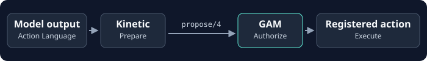

# Spectre Kinetic

Kinetic parses Action Language and prepares structured action proposals.
Its standalone runtime handles registries, retrieval and classifier pipelines.
Applications can also install the optional adapter in Spectre core 0.4.1.

[Standalone guide](docs/STANDALONE.md) · [Documentation index](docs/INDEX.md)

## Standalone installation

Add Kinetic from the GitHub branch `0.2.0` to your dependencies.

```elixir
{:spectre_kinetic, github: "elchemista/spectre_kinetic", branch: "0.2.0"}
```

Parse Action Language directly from your application.

```elixir
%{args: %{"TO" => "dev@example.com", "BODY" => "Hello"}} =
  SpectreKinetic.parse_al(~s(SEND EMAIL TO="dev@example.com" BODY="Hello"))
```

For planning against your application's tools, load a registry with
`SpectreKinetic.load_runtime/1` and call `SpectreKinetic.plan/3`. Application
code owns execution of the resulting proposal. See the
[standalone registry and planner example](docs/STANDALONE.md).

## Optional Spectre integration

Add Spectre Core from Hex and Kinetic from GitHub to an AgentServer application.

```elixir
defp deps do
  [
    {:spectre, "~> 0.4.1"},
    {:spectre_kinetic, github: "elchemista/spectre_kinetic", branch: "0.2.0"}
  ]
end
```

For sibling checkouts, replace these with `path: "../spectre"` and
`path: "../spectre_kinetic"` dependencies. Package integration tests use
`SPECTRE_PATH=../spectre mix test`.

### Register actions in the Stack

Pass your action module once with `actions:`. Kinetic registers every public
function in that module annotated with `@al`. To add another action, add its
annotation and function to the module. The Stack declaration stays the same.

```elixir
defmodule MyApp.MailActions do
  use SpectreKinetic
  @al ~s(SEND EMAIL TO="dev@example.com" BODY="Hello")
  @doc "Simulates sending an email for this example."
  @spec send_email(String.t(), String.t()) :: {:ok, map()}
  def send_email(to, body), do: {:ok, %{to: to, body: body, simulated: true}}
end

defmodule MyApp.MailAI do
  use Spectre.Stack
  install Spectre.Kinetic, actions: MyApp.MailActions
end
```

`@al` gives Kinetic an example of the Action Language that invokes the next
function. Here `SEND EMAIL` selects `send_email/2` and `TO` and `BODY` supply
its arguments. The registration also creates the GAM operation
`{:kinetic, :send_email}` using the default provider ID `:kinetic` and the
function name `:send_email`.

### Do I need `mode:` or `modes:`?

Both are optional. They set the action's effect classification in the catalog.
Use `:read` for reads, `:write` for changes such as sending an email and
`:destructive` for destructive changes such as deleting a record.

| Configuration | Effect |
| --- | --- |
| `actions: MyApp.MailActions` | Registers all annotated actions with an unspecified mode (`nil`). |
| `mode: :write` | Sets the default for every action in the module. |
| `modes: [send_email: :write]` | Sets the mode for the named function. Entries override the default. |

For example, with `mode: :write, modes: [lookup_contact: :read]`, a
`lookup_contact/1` action would be classified as a read and the rest as writes.
`mode: :closed_moves` is accepted for compatibility with older examples.
In 0.2.0 it has the same effect as leaving `mode:` unset. GAM permissions and
confirmation rules are set separately by the host.

### Generate, prepare and propose



The Agent routes the input to the Server. The Server generates Action Language
and passes it to Kinetic through the `kinetic/3` helper provided by
`tools: MyApp.MailAI`.

```elixir
defmodule MyApp.MailServer do
  use Spectre.Server, tools: MyApp.MailAI, prompt_root: "priv/mail/prompts"

  def handle_flow({:mail, :send}, _input, ctx),
    do: generate(ctx, :send, planning: false, on_result: :draft)

  def handle_result(:draft, {:generated, response}, ctx),
    do: kinetic(ctx, response, on_result: :prepared)

  def handle_result(:prepared, {:prepared, %{actions: [], text: text}}, ctx),
    do: respond(ctx, text)

  def handle_result(:prepared, {:prepared, %{actions: [proposal]}}, ctx) do
    propose(ctx, proposal.operation, proposal.args,
      proposal_metadata: proposal.metadata, on_result: :sent)
  end

  def handle_result(:sent, {:governed, %{outcome: %{status: :succeeded}}}, ctx),
    do: respond(ctx, "The simulated email action completed.")

  def handle_result(tag, result, ctx), do: super(tag, result, ctx)
end

defmodule MyApp.MailAgent do
  use Spectre.Agent, stack: MyApp.MailAI, server: MyApp.MailServer
  model(MyApp.TextModel)
  flow :mail do
    on(:send, regex: ~r/^send email/i)
  end
end
```

`MyApp.TextModel` is your model adapter. `prompt_root:` points to the directory
where `generate(ctx, :send, ...)` finds `priv/mail/prompts/send.text.heex`.
Create that file with this prompt.

```text
When the request includes a recipient address and a message body, return
one Action Language expression using <al>SEND EMAIL TO="..." BODY="..."</al>.
If either field is missing, ask for it in plain text.

<%= Spectre.Prompt.data(@input.text) %>
```

- `{:mail, :send}` pairs the Agent's flow and route with the Server callback.
- `planning: false` leaves preparation to Kinetic. `on_result:` selects the
  next `handle_result/3` clause by tag. Here `:draft` receives the model reply
  and `:prepared` receives Kinetic's action list.
- `propose/4` submits the prepared operation and arguments to GAM. It carries
  the original `proposal_metadata:` so Spectre can check the binding.
  `:sent` handles the observed outcome after execution.

At Server startup, enable that operation and require human confirmation.

```elixir
{:ok, server} = Spectre.Server.start_link(
  agent: MyApp.MailAgent, consumer: self(),
  gam: [operations: %{{:kinetic, :send_email} => [confirm: true]}])
{:ok, _interaction} =
  Spectre.Server.input(server, ~s(send email to dev@example.com with body "Hello"))
```

The `consumer:` receives the presentation and the result. It shows the
recipient and body, then submits the user's decision. After approval, the
registered action returns a simulated receipt. Use the same policy mechanism
for your application's mail executor. [Managed GAM](https://github.com/elchemista/spectre/blob/0.4.1/docs/MANAGED_GAM.md).

Pass the full generated response to Kinetic. Its `model_output` holds the
Action Language. To call the same binding by scope, use
`call_tool(ctx, {:kinetic, :interpret}, response, on_result: :prepared)`.
If the Stack installation uses `as:`, use that installation ID in the tuple.

## Result and recovery contract

`kinetic` returns `{:prepared, %{text: text, actions: proposals}}` to the named
`handle_result/3` callback. Preserve each proposal's provider, schema hash,
owner and scope metadata when calling `propose`. Planning never invokes the
action function. Empty/multiple proposals and errors are application decisions;
the single-proposal example intentionally falls back to the Server default.

The callback returns a context containing commands. Spectre checkpoints the
outbox before workers run, projects portable results and dispatches the next
callback. Streaming previews are not consolidated plans. Cognitive planning is
repeatable. The later governed effect has its own reconciliation lifecycle.


## Direct APIs and further reading

- [Standalone planning, classifiers, training and runtime guide](docs/STANDALONE.md)
- [Public API contract](docs/PUBLIC_API.md)
- [Migration guide](docs/MIGRATING_TO_SPECTRE_0_4.md)
- [Classifier training](TRAIN.md)
- [Changes in this branch](CHANGELOG.md)

## Runtime and examples

The generated `kinetic` helper also works in [Skill Server callbacks](https://github.com/elchemista/spectre/blob/0.4.1/docs/SKILLS.md).
Skills share the root's GAM Domain; enable governed operations on the root and
allow them in the mount's `governed:` references. The
[core tool guide](https://github.com/elchemista/spectre/blob/0.4.1/docs/STACK_TOOLS.md) covers scheduling and recovery.
[Managed GAM](https://github.com/elchemista/spectre/blob/0.4.1/docs/MANAGED_GAM.md) covers consent and registered execution.

See the [LiveView demo](https://github.com/elchemista/demo_spectre) for an application,
the [Spectre guides](https://spectre.guide) for articles, and the
[release audit](https://github.com/elchemista/spectre/blob/0.4.1/docs/RELEASE_0_4.md) for verified revisions.
